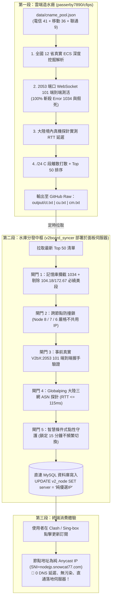

# Cloudflare 三網優選與 V2Board 直寫架構全景手冊 (SOP)

> **版本**：v4.5.0 (純 IP 面板直通版)  
> **更新時間**：2026-10-23  
> **核心宗旨**：徹底廢除 Cloudflare DNS 綁定模式，改採 **「GitHub Actions 雲端造水 + v2board_syncer 資料庫直寫純 IP」** 雙段閉環架構，實現 0 DNS 延遲、0 污染、真亞太直連。

---

## 一、 核心架構演進：為何放棄「綁 DNS」？

### 1. 舊版架構痛點（已徹底廢除）
- **舊做法**：篩選出 IP 後，調用 Cloudflare API 修改 `ct.yourdomain.com` 等 A 記錄。
- **致命傷**：
  1. 受限於各省 LocalDNS 緩存（TTL 60s 在很多地方會被強行緩存數十分鐘），故障節點無法即刻自癒；
  2. 二級域名極易被 GFW 針對性進行 SNI 阻斷或 DNS 劫持污染；
  3. 輪詢池內 Anycast IP 容易隨時動態漂移繞美西，客戶端無法及時感知。

### 2. 現行架構：純血兩段式直通（現行標準）



---

## 二、 三網優選域名資產清冊（2026-10-23 最新狀態）

程序在雲端運行的唯一輸入源文件為：**`data/cname_pool.json`**。

### 1. 中國電信 (CT) - 41 個大廠精選優選域名
全數支持大陸電信寬帶直連，大量命中新加坡（SG）與亞太優質大帶寬機房：

```text
wpengine.com            console.groq.com        www.liberty.co.uk       www.pedroshoes.com
www.goat.com            www.specialized.com     www.umbraco.com         www.zwilling.com
www.domain.com          www.cannondale.com      www.aweber.com          www.jago.com
www.saucony.com         www.bluehost.com        www.lululemon.com.hk    www.on-running.com
www.propertyguru.com.my mailerlite.com          www.charleskeith.com    www.selfridges.com
www.foodpanda.my        www.lululemon.co.kr     www.petzl.com           www.topping.audio
auth0.com               steelseries.com         www.aesop.com           www.akg.com
linear.app              www.casetify.com        codecanyon.net          makerworld.com
elements.envato.com     www.yslbeauty.com       www.foodpanda.com.tw    www.shopify.com
www.lululemon.co.jp     placeit.net             www.zendesk.com         www.glassdoor.com
www.omnisend.com
```

### 2. 中國移動 (CM) - 36 個實測直通香港 (HKG) VIP-Enterprise 域名
經端到端嚴格篩選，全部為 `VIP-Enterprise` 頂級站點，實測延時 20ms ~ 94ms：

```text
ridibooks.com           www.rhbgroup.com        www.alchemy.com         www.rome2rio.com
wiki.bambulab.com       www.amiami.jp           mailersend.com          www.garmin.com.sg
www.buy123.com.tw       www.casetify.com        store.ubi.com           www.chrono24.com
www.liberty.co.uk       www.highsnobiety.com    linear.app              www.3cecosmetics.com
www.hydroflask.com      makerworld.com          theordinary.com         www.fragrancenet.com
kinsta.com              www.garmin.co.jp        www.garmin.com.cn       www.propertyguru.com.sg
www.xendit.co           www.aesop.com           www.humblebundle.com    www.pedroshoes.com
www.foodpanda.sg        www.macpaw.com          www.garmin.com.hk       www.shopify.com
www.garmin.co.kr        www.dynadot.com         www.ssense.com          www.algolia.com
```

### 3. 中國聯通 (CU) - 9 個優選域名
覆蓋 4837 骨幹網直連優質站點：
`www.090902.xyz`、`224322.xyz`、`cf.877771.xyz`、`cfsaas.080112.xyz`、`cfyx.aliyun.20237737.xyz`、`eteaf.cf.3666888.xyz`、`cf.090227.xyz`、`bestcf.top`、`cf.877774.xyz`。

---

## 三、 下游同步核心：`v2board_syncer` 五道防護門禁

部署位置：面板伺服器 `/www/wwwroot/0n21.com/v2board_syncer`。  
運行指令：`python3 v2board_db_sync.py`（或設置 crontab 每 10~15 分鐘運行一次）。

| 閘門 | 名稱 | 作用與防護邏輯 |
| :---: | :--- | :--- |
| **閘門 1** | **記憶庫與三網繞美底線攔截** | 0ms 讀取 `state_cache.json` 剔除 24h 1034 毒 IP 與 2h 漂移超時黑名單；電信強制封殺 `104.18.`、`172.67.` 等必繞美前綴。 |
| **閘門 2** | **跨節點防撞車鎖與 C 段打散** | `Node 8` (SG 電信)、`Node 7` (JP 電信)、`Node 6` (HK 移動) 絕對禁止共用同一 IP，且強制打散在不同 `/24` 網段。 |
| **閘門 3** | **真實 V2bX 端到端 101 握手** | 帶節點真實 SNI / Port (2053) / WS Path (/ws) 握手，非 HTTP 101 立即淘汰並冷卻。 |
| **閘門 4** | **大陸境內 ASN 探針雙指標** | 依運營商對齊 AS4134/AS9808，要求丟包率 <= 50% 且境內平均延遲 <= 115ms（超標視為漂移至美西，淘汰冷卻 2 小時）。 |
| **閘門 5** | **智慧條件式黏性守護** | 現任 IP 若各項合格，鎖定保持 15 分鐘，避免頻繁替換造成客戶端反覆重連中斷。 |

---

## 四、 日常維護 SOP（極簡操作指引）

### 1. 我想新增或修改優選域名？
1. 本地打開 `data/cname_pool.json`；
2. 在對應運營商（`ct` 或 `cm` 或 `cu`）下新增 `{ "domain": "new-domain.com" }`；
3. 執行 Git 提交與推送：
   ```bash
   git add data/cname_pool.json data/
   git commit -m "feat: add new preferred domain"
   git push origin main
   ```
4. **完工**：GitHub Actions 會自動被觸發，30 分鐘內產出最新篩選結果，下游 `v2board_syncer` 自動吸納入庫！

### 2. 面板節點如何對應？
在伺服器 `/www/wwwroot/0n21.com/v2board_syncer/config.json` 中配置節點：
- `id: 8` $\rightarrow$ SG 新加坡（拉取 `ct` 表，偏好 SG）
- `id: 7` $\rightarrow$ JP 日本（拉取 `ct` 表，偏好 JP）
- `id: 6` $\rightarrow$ HK 香港（拉取 `cm` 表，偏好 HK）

---

### 五、 工作區清理紀要
- ❌ **已徹底移除**：`cf-trinet-optimizer`（綁 DNS 模組全部代碼與檔案已徹底刪除）。
- ✅ **唯一核心保留**：`cf-global-quadnet-feed`（即 GitHub `passerby7890/cfips`）。
