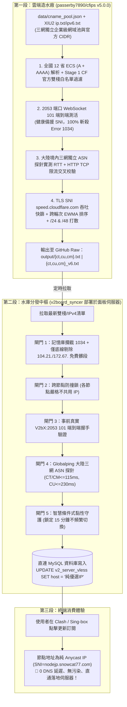

# Cloudflare 三網優選與 V2Board 直寫架構全景手冊 (SOP)

> **版本**：v5.0.0 (雙棧三網真機探針、TCP 限流交叉驗證與 TLS SNI 真實吞吐版)  
> **更新時間**：2026-11-25  
> **核心宗旨**：徹底廢除 Cloudflare DNS 綁定模式，改採 **「GitHub Actions 雲端雙棧造水 + v2board_syncer 資料庫直寫純 IP」** 雙段閉環架構，實現 0 DNS 延遲、0 污染、真亞太直連與防震盪自癒。

---

## 一、 核心架構演進：為何放棄「綁 DNS」？

### 1. 舊版架構痛點（已徹底廢除）
- **舊做法**：篩選出 IP 後，調用 Cloudflare API 修改 `ct.yourdomain.com` 等 A 記錄。
- **致命傷**：
  1. 受限於各省 LocalDNS 緩存（TTL 60s 在很多地方會被強行緩存數十分鐘），故障節點無法即刻自癒；
  2. 二級域名極易被 GFW 針對性進行 SNI 阻斷或 DNS 劫持污染；
  3. 輪詢池內 Anycast IP 容易隨時動態漂移繞美西，客戶端無法及時感知。

### 2. 現行架構：純血兩段式直通（現行標準）



---

## 二、 三網優選域名資產管理（`data/cname_pool.json`）

程序在雲端運行的核心輸入源文件為：**`data/cname_pool.json`**（目前涵蓋 147 個三網獨立域名組態）搭配 **`data/seeds_{ct,cu,cm}.txt`** 與 **XIU2 官方 CIDR (`data/cf_ranges.txt`, `data/cf_ranges_v6.txt`)**。

- **健康度自動追蹤**：每次執行後於 `output/cname_health.json` 即時產出每個網域之 2053 WS 101 存活率與 Error 1034 毒害率，便於定期清理失效站點。
- **物理落地矩陣與種子庫**：`data/carrier_landing_matrix.json` 記錄三網各段真實物理落地（如電信 `172.64.229.0/24` `#JP`、移動 `172.66.128.0/20` `#HK`、聯通 `162.159.128.0/20` `#HK`），並由 Globalping 真機實測動態覆蓋與校正。

---

## 三、 下游同步核心：`v2board_syncer` 五道防護門禁

部署位置：面板伺服器 `/opt/v2board_syncer`。  
運行指令：`python3 /opt/v2board_syncer/v2board_db_sync.py`（由寶塔排程每 10 分鐘自動運行一次）。

| 閘門 | 名稱 | 作用與防護邏輯 |
| :---: | :--- | :--- |
| **閘門 1** | **記憶庫與三網繞美底線攔截** | 0ms 讀取 `state_cache.json` 剔除 24h 1034 毒 IP 與 2h 漂移超時黑名單；僅底線剔除 `104.21.`、`172.67.` 等免費髒段。 |
| **閘門 2** | **跨節點防撞車鎖與 C 段打散** | `Node 8` (SG 電信)、`Node 7` (JP 電信)、`Node 6` (HK 移動) 絕對禁止共用同一 IP，且強制打散在不同 `/24` 網段。 |
| **閘門 3** | **真實 V2bX 端到端 101 握手** | 帶節點真實 SNI / Port (2053) / WS Path (/ws) 握手，非 HTTP 101 立即淘汰並冷卻。 |
| **閘門 4** | **大陸境內 ASN 探針雙指標** | 依運營商對齊 AS4134/AS4837/AS9808，要求丟包率 <= 50% 且境內延遲達標（CT/CM<=115ms, CU<=230ms）。 |
| **閘門 5** | **智慧條件式黏性守護** | 現任 IP 若各項合格，鎖定保持 15 分鐘，避免頻繁替換造成客戶端反覆重連中斷。 |

---

## 四、 日常維護 SOP（極簡操作指引）

### 1. 我想新增或修改優選域名？
1. 本地打開 `data/cname_pool.json`；
2. 在對應運營商（`ct` 或 `cm` 或 `cu`）下新增 `{ "domain": "new-domain.com" }`；
3. 執行 Git 提交與推送：
   ```bash
   git add data/cname_pool.json data/
   git commit -m "feat: add new preferred domain"
   git push origin main
   ```
4. **完工**：GitHub Actions 會自動被觸發，30 分鐘內產出最新篩選結果，下游 `v2board_syncer` 自動吸納入庫！

### 2. 面板節點如何對應？
在伺服器 `/opt/v2board_syncer/config.json`（權限 `chmod 600`）中配置節點：
- `id: 8` $\rightarrow$ SG 新加坡（拉取 `ct` 表，偏好 SG）
- `id: 7` $\rightarrow$ JP 日本（拉取 `ct` 表，偏好 JP）
- `id: 6` $\rightarrow$ HK 香港（拉取 `cm` 表，偏好 HK）

---

### 五、 工作區清理紀要
- ❌ **已徹底移除**：`cf-trinet-optimizer`（綁 DNS 模組全部代碼與檔案已徹底刪除）。
- ✅ **唯一核心保留**：`cf-global-quadnet-feed`（即 GitHub `passerby7890/cfips`）。
