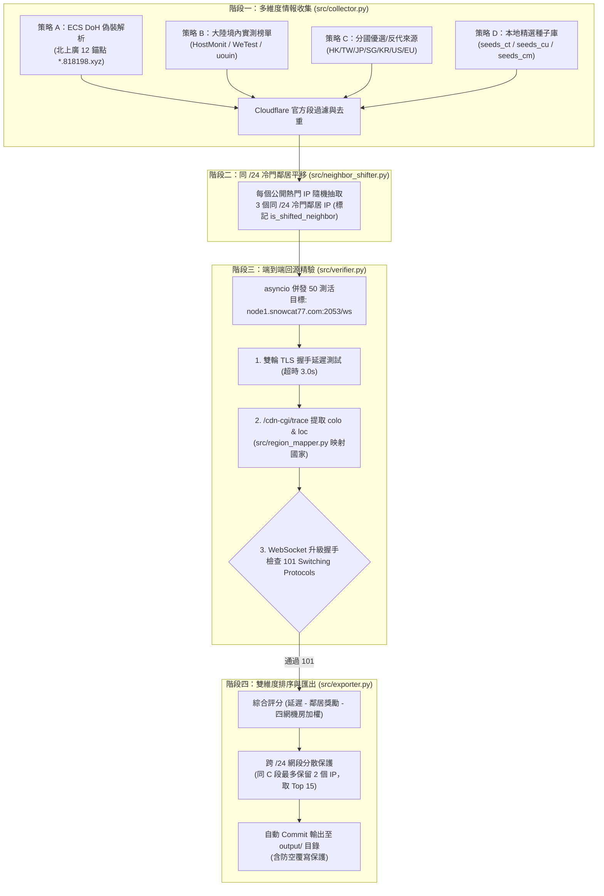

# CF-Global-QuadNet-Feed (Cloudflare 全球四網與多國優選 IP 自動產出系統)

> **GitHub Actions 雲端全自動化**：ECS 偽裝大陸四網錨點解析 + 境內公開榜單 + 同 `/24` 冷門鄰居平移演算法 + `node1.snowcat77.com:2053/ws` 真實 **TLS + WebSocket 101 Switching Protocols** 回源閉環測活。

---

## 1. 系統架構與設計定位

本系統徹底解決了傳統 Cloudflare 優選腳本的兩大根本問題：
1. **GitHub Actions / 海外 VPS 的 Anycast 測速失真**：海外機器直連 Cloudflare 測得的超低延遲往往只是海外機房到 CF 邊緣的延遲，而非大陸境內三網訪問的路徑。本系統透過 **Google DoH API + EDNS Client Subnet (ECS)**，直接攜帶北上廣 12 個電信/聯通/移動/教育網骨幹錨點的 IP 段向權威 DNS 查詢，精準取得 DNS 派發給大陸各地三網的入口 IP！
2. **公開熱門 IP 在晚高峰被 QoS 限速擠爆**：針對收集到的公開榜單熱門 IP，創新採用 **「同 /24 網段冷門鄰居平移演算法」**，在同一個 `/24` 網段內隨機抽取 3 個未公開的冷門鄰居 IP 一併測活，並享有 `-15ms` 優先加權，保障晚高峰時段擁有獨立、乾淨且低擁塞的優選通道。



---

## 2. 外部機器消費端調用方式 (無須任何 Token)

本系統部署於 GitHub Actions 後，將自動定時發布最新的有效優選 IP 至倉庫的 `output/` 目錄。**您在另一台機器上完全無需存放 Cloudflare API Token**，只需透過 `curl` 即可直接拉取 100% 通過 `node1.snowcat77.com:2053/ws` 驗證的可用節點！

### 2.1 快速 curl 單一清單
只需將 URL 中的 `<帳號>` 與 `<倉庫名>` 替換為您的 GitHub 倉庫：

```bash
# 1. 取得大陸電信 (CT) Top 15 優選 IP
curl -sSL https://raw.githubusercontent.com/passerby7890/cfips/main/output/carriers/ct.txt

# 2. 取得大陸聯通 (CU) Top 15 優選 IP
curl -sSL https://raw.githubusercontent.com/passerby7890/cfips/main/output/carriers/cu.txt

# 3. 取得大陸移動 (CM) Top 15 優選 IP
curl -sSL https://raw.githubusercontent.com/passerby7890/cfips/main/output/carriers/cm.txt

# 4. 取得大陸教育網 (EDU) Top 15 優選 IP
curl -sSL https://raw.githubusercontent.com/passerby7890/cfips/main/output/carriers/edu.txt

# 5. 取得日本 (JP - NRT/KIX) Top 15 優選 IP
curl -sSL https://raw.githubusercontent.com/passerby7890/cfips/main/output/countries/jp.txt

# 6. 取得台灣 (TW - TPE/KHH) Top 15 優選 IP
curl -sSL https://raw.githubusercontent.com/passerby7890/cfips/main/output/countries/tw.txt

# 7. 取得香港 (HK - HKG) Top 15 優選 IP
curl -sSL https://raw.githubusercontent.com/passerby7890/cfips/main/output/countries/hk.txt

# 8. 取得完整 JSON 總表 (含機房、延遲、冷門鄰居標籤與評分)
curl -sSL https://raw.githubusercontent.com/passerby7890/cfips/main/output/best_ips.json
```

### 2.2 使用內建同步腳本 (`scripts/fetch_ips.sh`)
本專案提供了一鍵消費端腳本，支援自訂下載路徑以及選配的 Cloudflare DNS A 記錄自動同步：

```bash
# 拉取電信 IP 並顯示
bash scripts/fetch_ips.sh ct

# 拉取日本 IP 並儲存至指定檔案
bash scripts/fetch_ips.sh jp /etc/v2ray/jp_ips.txt

# 同步拉取全部四網與各國清單
bash scripts/fetch_ips.sh all

# [選配] 拉取電信優選 IP 並自動更新自己的 Cloudflare DNS A 記錄
export CF_API_TOKEN="your_cloudflare_api_token"
export CF_ZONE_ID="your_zone_id"
export CF_RECORD_NAME="ct.yourdomain.com"
bash scripts/fetch_ips.sh ct
```

---

## 3. 專案目錄結構

```text
cf-global-quadnet-feed/
├── .github/
│   └── workflows/
│       └── update_ips.yml          # GitHub Actions 自動定時排程 (含晚高峰加密) 與自動 Push
├── config/
│   └── config.yaml                 # 源站參數 (node1.snowcat77.com:2053/ws) 與四網/國家規則配置
├── data/
│   ├── cn_anchors.json             # 北上廣四網 12 個基準錨點 (IPv4/IPv6/818198.xyz 域名)
│   ├── seeds_ct.txt                # 電信精選種子 IP / CIDR 池
│   ├── seeds_cu.txt                # 聯通精選種子 IP / CIDR 池
│   └── seeds_cm.txt                # 移動精選種子 IP / CIDR 池
├── output/
│   ├── carriers/
│   │   ├── ct.txt                  # [自動生成] 大陸電信 Top 15 優選 IP
│   │   ├── cu.txt                  # [自動生成] 大陸聯通 Top 15 優選 IP
│   │   ├── cm.txt                  # [自動生成] 大陸移動 Top 15 優選 IP
│   │   └── edu.txt                 # [自動生成] 大陸教育網 Top 15 優選 IP
│   ├── countries/
│   │   ├── hk.txt                  # [自動生成] 香港 HKG 優選 IP
│   │   ├── tw.txt                  # [自動生成] 台灣 TPE/KHH 優選 IP
│   │   ├── jp.txt                  # [自動生成] 日本 NRT/KIX 優選 IP
│   │   ├── sg.txt                  # [自動生成] 新加坡 SIN 優選 IP
│   │   ├── kr.txt                  # [自動生成] 韓國 ICN 優選 IP
│   │   ├── us.txt                  # [自動生成] 美國美西 SJC/LAX/SEA 優選 IP
│   │   └── eu.txt                  # [自動生成] 歐洲 FRA/AMS/LHR 優選 IP
│   └── best_ips.json               # [自動生成] 包含四網與各國完整指標的 JSON 總表
├── src/
│   ├── __init__.py
│   ├── region_mapper.py            # IATA 三字機場代碼 (colo) 與國家/地區映射表
│   ├── collector.py                # ECS DoH 偽裝解析 + 境內榜單抓取 + 分國源 + 本地種子
│   ├── neighbor_shifter.py         # 同 /24 網段冷門鄰居抽樣展開器
│   ├── verifier.py                 # 非同步 TLS + Trace (colo) + WebSocket 101 真實回源驗證器
│   └── exporter.py                 # 雙維度加權排序、跨 /24 網段去重與檔案匯出
├── scripts/
│   ├── fetch_ips.sh                # 給「另一台機器」一鍵拉取指定四網/國家 IP 並選配更新 CF DNS 的腳本
│   └── tcping_cn_anchors.py        # 給「另一台機器/VPS」用來 TCPing 北上廣 12 個錨點 (80/443) 的探測工具
├── main.py                         # CLI 主程式入口
├── requirements.txt                # Python 依賴套件 (aiohttp, PyYAML, requests)
└── README.md                       # 完整說明文件
```

---

## 4. 北上廣四網基準錨點資料庫 (`data/cn_anchors.json`)

本系統採用最新 2.0 遷移之北上廣四網可用地址，包含動態解析域名與備用靜態 IP：

| 地區 | 運營商 | 代碼 | IPv4 地址 | IPv6 地址 | 動態維護域名 (2.0) |
| :--- | :--- | :--- | :--- | :--- | :--- |
| 廣州 | 電信 | `gz_ct` | `183.47.126.35` | `240e:97c:2f:3000::44` | `gz.telecom.818198.xyz` |
| 廣州 | 聯通 | `gz_cu` | `157.148.58.29` | `2408:8756:f50:1001::c` | `gz.unicom.818198.xyz` |
| 廣州 | 移動 | `gz_cm` | `120.233.18.250` | `2409:8c54:871:1001::12` | `gz.mobile.818198.xyz` |
| 廣州 | 教育 | `gz_edu` | `202.116.64.8` | `2001:da8:2004:1000:202:116:160:17` | `gz.edu.818198.xyz` |
| 上海 | 電信 | `sh_ct` | `101.226.94.124` | `240e:e1:aa00:4000::24` | `sh.telecom.818198.xyz` |
| 上海 | 聯通 | `sh_cu` | `140.207.122.197` | `2408:80f1:21:5003::a` | `sh.unicom.818198.xyz` |
| 上海 | 移動 | `sh_cm` | `117.185.253.224` | `2409:8c1e:75b0:3003::26` | `sh.mobile.818198.xyz` |
| 上海 | 教育 | `sh_edu` | `202.120.2.119` | `2001:da8:8000:6fc0:102:1200:2:48` | `sh.edu.818198.xyz` |
| 北京 | 電信 | `bj_ct` | `49.7.37.74` | `2400:89c0:1053:3::69` | `bj.telecom.818198.xyz` |
| 北京 | 聯通 | `bj_cu` | `111.206.209.44` | `2400:89c0:1013:3::54` | `bj.unicom.818198.xyz` |
| 北京 | 移動 | `bj_cm` | `112.34.111.194` | `2409:8c00:8421:1303::55` | `bj.mobile.818198.xyz` |
| 北京 | 教育 | `bj_edu` | `166.111.4.100` | `2402:f000:1:404:166:111:4:100` | `bj.edu.818198.xyz` |

在外部機器上，可執行探測工具檢測連線品質：
```bash
python scripts/tcping_cn_anchors.py
```

---

## 5. 本機執行與除錯

### 5.1 安裝依賴
```bash
python3 -m venv .venv
source .venv/bin/activate  # Windows: .venv\Scripts\activate
pip install -r requirements.txt
```

### 5.2 執行完整回源驗證流程
```bash
python main.py
```

### 5.3 模擬執行模式 (Dry Run)
不覆寫 `output/` 目錄，將結果輸出至 `output_dryrun/`：
```bash
python main.py --dry-run
```

---

## 6. GitHub Actions 自動化排程

在 `.github/workflows/update_ips.yml` 中已配置：
- **常規排程**：每 4 小時執行一次 (`0 */4 * * *`)
- **北京時間晚高峰加密排程**：
  - 19:30 (UTC 11:30)
  - 21:00 (UTC 13:00)
  - 22:30 (UTC 14:30)
- **手動觸發**：支援 GitHub 網頁 Actions 介面點擊 `workflow_dispatch` 立即執行。
- **自動 Commit & Push**：當驗證出新的合格 IP 時，自動以 `github-actions[bot]` 提交並推送到主分支。

---

## 7. License

MIT License. Designed with excellence for high-performance Cloudflare proxy infrastructure.
