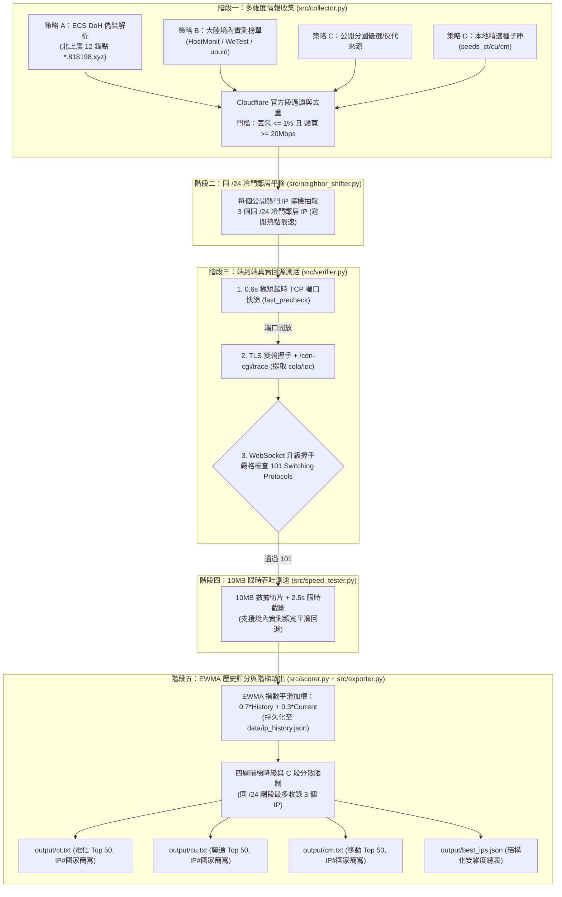

# CF-Global-QuadNet-Feed (Cloudflare 三網前 50 優選 IP 自動產出系統)

> **版本**：`v3.1.0` (ITDog 同款：全國七大區三網 ECS 深度 DNS 解析榨取與防牆測活引擎)  
> **運營交付手冊**：詳見 [docs/OPERATIONS_MANUAL.md](docs/OPERATIONS_MANUAL.md)  
> **GitHub Actions 雲端全自動化**：覆蓋華東、華南、華中、華北、西南、西北、東北七大區 12 省三網真實子網 (`data/cn_ecs_matrix.json`) + `dnspython` RFC 7871 ECSOption 二進位封包 + 權威 NS 直查與 RFC 8484 DoH + 官方邊緣憑證 (`cdnjs.cloudflare.com:443`) 防牆測活 + 跨省命中率 (`hit_ratio`) 權重排序，每 30 分鐘全自動更新三網前 50 優選清單。

---

## 📖 專案交付與運營文件
- 📘 **完整運營手冊**：請參閱 [docs/OPERATIONS_MANUAL.md](docs/OPERATIONS_MANUAL.md)，涵蓋架構原理、資產維護 SOP、自測驗收規範、Clash/Sing-box 客戶端訂閱範例與故障排查。
- 📝 **版本更新歷史**：請參閱 [CHANGELOG.md](CHANGELOG.md)。
- 💡 **架構演化筆記**：請參閱 [DEV_NOTES.md](DEV_NOTES.md)。

本系統構建於兩段分離的傳輸路徑之上：
- **前半段 (大陸客戶端 → Cloudflare 邊緣節點)：** 走普通公網，受限於國際出口擁塞、晚高峰潮汐與省級防火牆動態 QoS 限速。此段是最易發生丟包與斷流的瓶頸。
- **後半段 (Cloudflare 邊緣節點 → 落地 VPS):** 走 Cloudflare 全球私有光纖骨幹網回源至指定 VPS（`70.36.96.110:2053`）。此段具備高穩定性與低丟包特性。

### 關鍵工程矛盾與對策 (Engineering Fixes)
1. **海外 Runner 測速失真矛盾：**
   - *矛盾：* GitHub Actions 伺服器位於歐美機房，其發起的下載測速僅代表「海外機房 → CF」的數百兆頻寬，無法反映「大陸境內 → CF」的真實出口帶寬。
   - *對策：* 境內頻寬指標改由**境內實測情報源（WeTest、HostMonit 等）提取**，作為網段基礎分；GitHub 上的 `speed_tester.py` 嚴格定位為「端到端回源頻寬與節點抗過載快篩」，設定「10MB 切片 + 2.5 秒限時截斷」。
2. **同 /24 網段平移的假死損耗矛盾：**
   - *矛盾：* 隨機平移抽樣的冷門鄰居 IP 可能未在該機房開放 `2053` 端口，若直接執行 2.5 秒測速會浪費大量時間。
   - *對策：* 引入 `fast_precheck()`，以極短的異步 TCP 握手（0.6 秒超時）進行前置快篩，未開放端口者瞬間剔除。
3. **短期衝刺型 IP 誤判矛盾：**
   - *矛盾：* 某些 IP 剛好在測速的 2 秒內爆發，但連線 10 分鐘後極度不穩定。
   - *對策：* 引入微型狀態持久化 `data/ip_history.json`，計算 EWMA 指數加權平均分：
     $$\text{Final\_Score} = 0.7 \times \text{History\_Score} + 0.3 \times \text{Current\_Score}$$
     只有多次排程均穩定的節點才能維持在 Top 50。
4. **輸出檔案精簡與跨 C 段抗 QoS：**
   - 簡化為 `output/ct.txt` (中國電信)、`output/cu.txt` (中國聯通)、`output/cm.txt` (中國移動) 三個核心檔案，取消多檔案國家目錄分散。
   - 每個檔案嚴格收錄綜合評分最高的前 50 個優選節點。
   - 每一行固定格式化為 `<IP>#<國家簡寫>`（例如：`172.67.140.251#TW` 或 `104.16.132.229#US`），國家簡寫由該 IP 的 `colo` 透過 `region_mapper` 精確解析。
   - 同一個 `/24` 網段最多收錄 3 個 IP，防止單一 C 段遭受 QoS 靶向封鎖時導致全盤斷連。



---

## 二、 外部調用與訂閱方式 (無須 Token)

本系統每 30 分鐘由 GitHub Actions 自動更新，產出成果直接以標準文字檔呈現，相容於所有主流客戶端（Clash、Mihomo、Sing-box、V2Ray、Shadowrocket 等）：

### 1. 輸出檔案清單

| 運營商分類 | 匯出檔案路徑 | 節點數量 | 行格式範例 |
| :--- | :--- | :--- | :--- |
| **中國電信 (CT)** | `output/ct.txt` | Top 50 | `104.19.137.24#TW` |
| **中國聯通 (CU)** | `output/cu.txt` | Top 50 | `162.159.236.175#TW` |
| **中國移動 (CM)** | `output/cm.txt` | Top 50 | `172.67.67.189#TW` |
| **結構化詳細總表** | `output/best_ips.json` | 完整元數據 | 包含機房、延遲、丟包率、頻寬與評分 |

### 2. 快速 curl 單一清單

```bash
# 1. 取得中國電信 (CT) Top 50 優選 IP
curl -sSL https://raw.githubusercontent.com/passerby7890/cfips/main/output/ct.txt

# 2. 取得中國聯通 (CU) Top 50 優選 IP
curl -sSL https://raw.githubusercontent.com/passerby7890/cfips/main/output/cu.txt

# 3. 取得中國移動 (CM) Top 50 優選 IP
curl -sSL https://raw.githubusercontent.com/passerby7890/cfips/main/output/cm.txt

# 4. 取得完整結構化 JSON 總表
curl -sSL https://raw.githubusercontent.com/passerby7890/cfips/main/output/best_ips.json
```

若您的消費端腳本僅需純 IP，可透過 `cut` 快速分離：
```bash
curl -sSL https://raw.githubusercontent.com/passerby7890/cfips/main/output/ct.txt | cut -d'#' -f1
```

---

## 三、 本地開發與手動執行

### 1. 安裝環境依賴
```bash
# 建議使用 Python 3.11 或 3.12
pip install -r requirements.txt
```

### 2. 本地執行流水線
```bash
# 完整執行收集、快篩、回源 101 驗證、測速與輸出
python main.py

# 模擬測試模式（不覆寫 output/ 目錄）
python main.py --dry-run

# 自訂併發數
python main.py --concurrency 50
```

---

## 四、 授權協議與免責聲明

- 本專案僅供網路連線架構優化、路由分析與學術研究使用。
- 嚴禁將本系統用於任何違反當地法律法規之用途。
