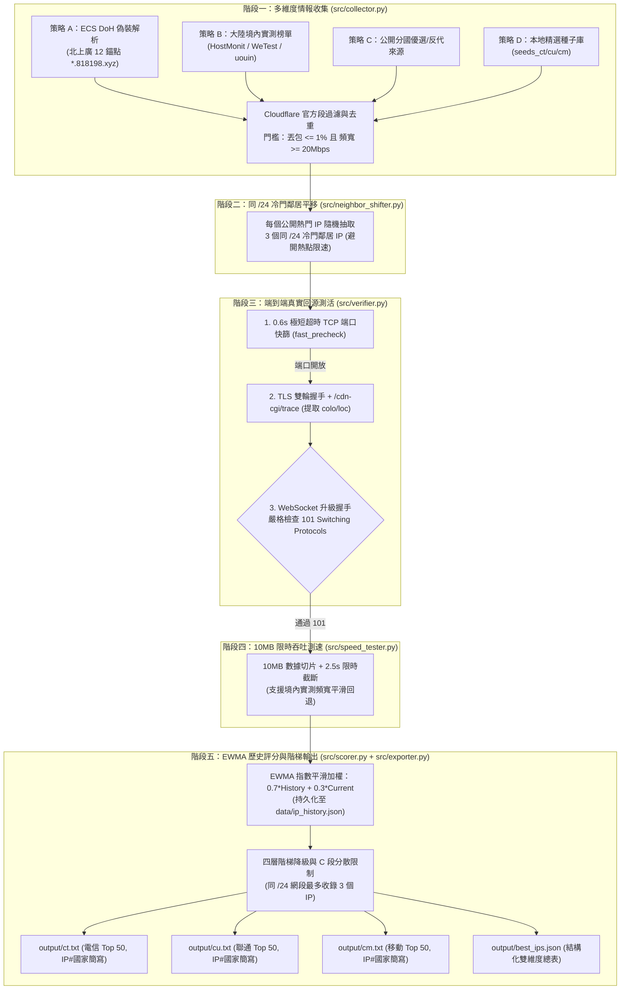

# CF-Global-QuadNet-Feed (Cloudflare 三網雙棧優選 IP 自動產出系統)

> **版本**：`v5.0.0` (三網真機雙棧實測、ICMP 限流 TCP 交叉校驗、TLS SNI 真實吞吐篩查與跨輪次 EWMA 穩定評分系統)  
> **GitHub Actions 雲端全自動化**：覆蓋七大區 12 省三網真實 ECS (`data/cn_ecs_matrix.json`) `A` + `AAAA` 雙棧解析 + XIU2 官方 `ip.txt`/`ipv6.txt` 子網智慧探索 + `2053` WebSocket `101` 握手去毒 + Globalping 大陸多省 ASN 探針實測（含 TCP 限流交叉驗證）+ `speed.cloudflare.com:443` 吞吐篩查 + 跨輪次 EWMA 排序，每 30 分鐘全自動更新雙棧三網清單。

---

## 📖 專案交付與運營文件
- 📘 **架構演進與 SOP 手冊**：請參閱 [ARCHITECTURE_AND_SOP.md](ARCHITECTURE_AND_SOP.md)。
- 📝 **版本更新歷史**：請參閱 [CHANGELOG.md](CHANGELOG.md)。
- 💡 **架構演化筆記**：請參閱 [DEV_NOTES.md](DEV_NOTES.md)。

本系統構建於兩段分離的傳輸路徑之上：
- **前半段 (大陸客戶端 → Cloudflare 邊緣節點)：** 依電信 (AS4134/4812)、聯通 (AS4837/17621)、移動 (AS9808/56041) 獨立出境路由決定真實亞太或繞美落地。
- **後半段 (Cloudflare 邊緣節點 → 落地源站)：** 嚴格透過健康備援 SNI (`nodesg/nodehk/nodejp.snowcat77.com:2053/ws?ed=2048`) 實測 HTTP `101 Switching Protocols`，100% 攔截 Error 1034 / 403 假活節點。

### 核心工程設計 (v5.0.0)
1. **三網真機探針與 ICMP 限流交叉校驗 (`src/cn_real_tester.py`)**：
   - 當大陸移動/聯通市級探針出現亞太低延遲但 ICMP 限流顯示 `20%~65%` 假丟包時，發起 HTTP `/cdn-cgi/trace` 交叉驗證真實 TCP 握手與 `CF-RAY` IATA 機房，避免黃金節點偶發震盪淘汰。
2. **TLS SNI 真實吞吐篩查 (`src/speed_tester.py`)**：
   - 使用 Raw TLS Socket (`server_hostname="speed.cloudflare.com"`, port `443`) 直接下載 `/__down?bytes=2097152`，淘汰 `< 2.0 Mbps` 或非 200 異常節點。
3. **跨輪次子網 EWMA 穩定性評分 (`src/scorer.py`, `data/ip_history.json`)**：
   - 結合 `0.7 × 當輪延遲 + 0.3 × 歷史 EWMA 延遲`，優先推薦長期穩定的亞太直連網段。
4. **IPv4 + IPv6 雙棧三網獨立輸出 (`output/*.txt`, `output/best_ips.json`)**：
   - IPv4 (`ct.txt`, `cu.txt`, `cm.txt`): 每檔最多 50 筆，同 `/24` <= 3 顆，禁 `#US`/`#CF`。
   - IPv6 (`ct_v6.txt`, `cu_v6.txt`, `cm_v6.txt`): 每檔最多 30 筆，同 `/48` <= 3 顆，禁 `#US`/`#CF`。



---

## 二、 外部調用與訂閱方式 (無須 Token)

本系統每 30 分鐘由 GitHub Actions 自動更新，產出成果直接以標準文字檔呈現，相容於所有主流客戶端（Clash、Mihomo、Sing-box、V2Ray、Shadowrocket 等）：

### 1. 輸出檔案清單

| 運營商分類 | 匯出檔案路徑 | 節點數量 | 行格式範例 |
| :--- | :--- | :--- | :--- |
| **中國電信 (CT v4)** | `output/ct.txt` | 最多 50 筆 | `172.64.229.2#JP` |
| **中國聯通 (CU v4)** | `output/cu.txt` | 最多 50 筆 | `162.159.130.10#HK` |
| **中國移動 (CM v4)** | `output/cm.txt` | 最多 50 筆 | `172.66.133.2#HK` |
| **中國電信 (CT v6)** | `output/ct_v6.txt` | 最多 30 筆 | `2606:4700:3033::1#JP` |
| **中國聯通 (CU v6)** | `output/cu_v6.txt` | 最多 30 筆 | `2606:4700:3034::1#HK` |
| **中國移動 (CM v6)** | `output/cm_v6.txt` | 最多 30 筆 | `2606:4700:3035::1#HK` |
| **結構化詳細總表** | `output/best_ips.json` | 完整雙棧元數據 | 含 IPv4/IPv6 機房、延遲、EWMA、丟包率與實測頻寬 |

### 2. 快速 curl 單一清單

```bash
# 1. 取得中國電信 (CT) Top 50 優選 IP
curl -sSL https://raw.githubusercontent.com/passerby7890/cfips/main/output/ct.txt

# 2. 取得中國聯通 (CU) Top 50 優選 IP
curl -sSL https://raw.githubusercontent.com/passerby7890/cfips/main/output/cu.txt

# 3. 取得中國移動 (CM) Top 50 優選 IP
curl -sSL https://raw.githubusercontent.com/passerby7890/cfips/main/output/cm.txt

# 4. 取得完整結構化 JSON 總表
curl -sSL https://raw.githubusercontent.com/passerby7890/cfips/main/output/best_ips.json
```

若您的消費端腳本僅需純 IP，可透過 `cut` 快速分離：
```bash
curl -sSL https://raw.githubusercontent.com/passerby7890/cfips/main/output/ct.txt | cut -d'#' -f1
```

---

## 三、 本地開發與手動執行

### 1. 安裝環境依賴
```bash
# 建議使用 Python 3.11 或 3.12
pip install -r requirements.txt
```

### 2. 本地執行流水線
```bash
# 完整執行收集、快篩、回源 101 驗證、測速與輸出
python main.py

# 模擬測試模式（不覆寫 output/ 目錄）
python main.py --dry-run

# 自訂併發數
python main.py --concurrency 50
```

---

## 四、 授權協議與免責聲明

- 本專案僅供網路連線架構優化、路由分析與學術研究使用。
- 嚴禁將本系統用於任何違反當地法律法規之用途。
