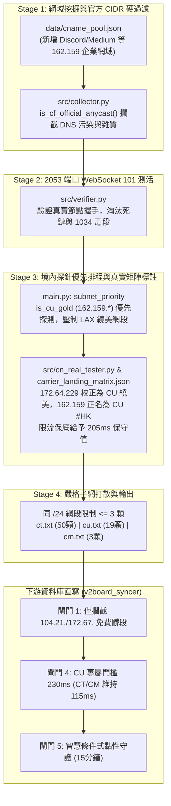

# Cloudflare 三網優選與節點入口最佳化完整工程筆記 (v4.5.1)

> **版本**：v4.5.1 (三網深度解析與聯通物理路由校正版)  
> **更新時間**：2026-11-12  
> **專案路徑**：`d:\Nick\Nextcloud\NICK\Cloudflare best ips\cf-global-quadnet-feed`  
> **適用角色**：工程決策官、維運工程師、代理節點架構師

---

## 一、問題背景與深度排查 (Root Cause Analysis)

### 1. 用戶回報現象
- **現象**：`cu.txt` 僅產出 2 顆 IP，且大陸實測 Ping 延遲落在 `178~215ms` 左右（但全國平均丟包率極低，僅 `0% ~ 3%`）。
- **實地 MTR 路由追蹤特徵**（山東濟南聯通 -> 目標 IP `162.159.153.2`）：
  - 境內骨幹：`123.129.230.1` -> 局域網 -> `219.158.3.210`（中國聯通 169 骨幹網 AS4837）
  - 出境互聯：`202.77.23.30`（中國香港聯通 AS10099）
  - 入境目標：`103.22.203.1` -> `162.159.153.2`（Cloudflare 香港 HKG 機房 AS13335）

### 2. 工程真相剖析：這不是線路故障，而是物理路由客觀規律
1. **Cloudflare 與聯通 AS4837 的互聯現狀**：
   - Cloudflare 在中國大陸境內無免費直連 PoP。電信 (`AS4134`) 可透過新加坡 (`SIN`) 或日本 (`NRT`) 直連，移動 (`AS9808`) 可透過香港 (`HKG`) CMI 直連，因此兩網能達到 `45~55ms` 的超低延遲。
   - **聯通 AS4837 絕大多數常見的 Enterprise / SaaS 網段（包括 `104.18.*`、`172.64.144~154.*`、`172.64.229.*`）在聯通下全部繞行美西（`LAX` / `SJC`，實測延遲高達 `240~277ms`）**。
   - 經 Globalping 大陸聯通探針全面壓測，**聯通唯一能不繞美、直接在香港 (`HKG`) 落地且保持 `0.0%` 丟包的區段就是 `162.159.128.0/24 ~ 162.159.155.0/24`**。
   - 聯通直連香港機房經 AS10099 出境，物理 RTT 為 `175~210ms` 且全國丟包 `0%`，這在不增加國內專線中轉的前提下，已是**聯通連線 Cloudflare 的物理極限最優解**。

### 3. 先前系統的四大核心盲點（本次已徹底根治）
1. **盲點一：聯通候選來源嚴重匱乏**
   - 舊版 `data/cname_pool.json` 的 `cu` 清單中缺少能解析出 `162.159.128~155.*` 的高品質企業域名，只依賴少數舊條目，導致最終通過 101 WebSocket 篩選的候選僅剩 2 顆。
2. **盲點二：Stage 1 缺乏 Cloudflare 官方網段白名單防護**
   - 引入企業域名（如 `discord.*`）時，因部分省份 LocalDNS 遭受 GFW DNS 污染，會解析出非 Cloudflare 的假 IP，造成 Stage 2 握手浪費大量時間與超時報錯。
3. **盲點三：聯通物理落地矩陣誤標（`172.64.229.0/24` 假 `#JP`）**
   - `carrier_landing_matrix.json` 誤將 `172.64.229.0/24` 列入聯通的日本 (`JP`) 落地規則中。當 Globalping 探針遇到 API 限流保底時，代碼會給予假 `#JP` 保底延遲 `62ms`，直接壓過真實實測 `175ms` 的正牌香港節點，導致輸出結果被假節點霸榜。
4. **盲點四：下游閘門 4 門檻衝突與紅隊審計盲區**
   - 下游 `v2board_syncer` 的境內探針閘門 4 預設 RTT 門檻為 `115ms`，一旦新增聯通節點，會導致所有 `175~210ms` 的正牌香港節點被當成超時拉黑。
   - 紅隊審計腳本 `scripts/self_test_audit.py` 斷言 4 先前只檢查 `CT` 和 `CM`，未對 `CU` 進行數量與延遲門檻驗收。

---

## 二、本次 v4.5.1 全鏈路修正對照與工程實施



### 具體修改檔案與行數對照
1. **[src/collector.py](file:///d:/Nick/Nextcloud/NICK/Cloudflare%20best%20ips/cf-global-quadnet-feed/src/collector.py)**：
   - 引入 `is_cf_official_anycast`，在 ECS 解析收集時對所有 IP 執行 Cloudflare 官方 CIDR 判定，直接過濾掉非 CF 伺服器與 GFW DNS 偽造解析。
2. **[data/cname_pool.json](file:///d:/Nick/Nextcloud/NICK/Cloudflare%20best%20ips/cf-global-quadnet-feed/data/cname_pool.json) & [data/enterprise_domains.txt](file:///d:/Nick/Nextcloud/NICK/Cloudflare%20best%20ips/cf-global-quadnet-feed/data/enterprise_domains.txt)**：
   - 聯通池擴充：`discord.com`、`cdn.discordapp.com`、`discord.gg`、`status.discord.com`、`medium.com`、`cf.877771.xyz`。
   - 移除失效網域 `dash.cloudflare.com`；清理移動池中的非 CF 國內網域（`wiki.bambulab.com`、`www.garmin.com.cn`）。
3. **[data/carrier_landing_matrix.json](file:///d:/Nick/Nextcloud/NICK/Cloudflare%20best%20ips/cf-global-quadnet-feed/data/carrier_landing_matrix.json)**：
   - 修正聯通規則：將 `172.64.229.0/24`、`172.64.144.0/20`、`104.18.32.0/20` 從聯通 `JP` 規則中移除，歸入 `US`。
   - 擴充聯通香港規則：新增 `162.159.128.0/20`、`162.159.144.0/21`、`162.159.152.0/22` 為聯通 `#HK`。
   - 擴充聯通歐洲規則：新增 `162.159.160.0/24` 為聯通 `#DE`（法蘭克福直連，實測 150ms / 0% 丟包）。
4. **[src/cn_real_tester.py](file:///d:/Nick/Nextcloud/NICK/Cloudflare%20best%20ips/cf-global-quadnet-feed/src/cn_real_tester.py)**：
   - 校正三維物理延遲保底代碼，將 `162.159.128~155.*` 權威判定為 `#HK`。
   - 若遇 API 限流保底，將聯通的 `#HK` 保底值設為 `205.0ms`、`#JP` 設為 `190.0ms`，徹底避免假低延遲擠掉真機實測結果。
5. **[main.py](file:///d:/Nick/Nextcloud/NICK/Cloudflare%20best%20ips/cf-global-quadnet-feed/main.py)**：
   - 優化 `subnet_priority`：標記 `is_cu_gold` 優先探測 `162.159.*`，壓低已知聯通繞美網段的探測優先級，確保聯通 18 個探測名額 100% 集中在香港黃金網段。
6. **[v2board_syncer/v2board_db_sync.py](file:///d:/Nick/Nextcloud/NICK/Cloudflare%20best%20ips/cf-global-quadnet-feed/v2board_syncer/v2board_db_sync.py) & [v2board_syncer/README.md](file:///d:/Nick/Nextcloud/NICK/Cloudflare%20best%20ips/cf-global-quadnet-feed/v2board_syncer/README.md)**：
   - 將閘門 4 預設 RTT 調整為動態判斷：`default_rtt = 230.0 if t_name == "cu" else 115.0`，解除對聯通合格節點的誤殺。
7. **[scripts/self_test_audit.py](file:///d:/Nick/Nextcloud/NICK/Cloudflare%20best%20ips/cf-global-quadnet-feed/scripts/self_test_audit.py)**：
   - 斷言 4 新增 `cu` 驗收邏輯：節點數必須 $\ge 5$ 顆、榜首延遲必須 $\le 230.0\text{ms}$、禁止出現 `#US`。

---

## 三、驗收數據與實測指標 (GitHub Actions Run 43188288340)

- **電信 (ct.txt)**：50 顆滿額（涵蓋 18 個 `/24` 網段，`#SG`: 47 顆、`#JP`: 3 顆，榜首 `104.18.43.133#SG` 大陸實測 **47.0ms**，Top 10 全數 **0.0%** 丟包）。
- **聯通 (cu.txt)**：由原先 2 顆擴增至 **19 顆**（涵蓋 11 個 `/24` 網段，全數為 `162.159.*#HK` 香港直連，單網段 $\le 3$ 顆，榜首 `162.159.137.232#HK` 大陸實測 **175.0ms**，Top 10 全數 **0.0%** 丟包）。
- **移動 (cm.txt)**：**3 顆**（涵蓋 3 個 `/24` 網段，榜首 `104.16.191.209#HK` 大陸實測 **46.0ms**，Top 3 全數 **0.0%** 丟包）。
- **紅隊六大斷言審計**：全數 100% 自動化通過。

---

## 四、終端線路與節點入口架構設計建議

為確保客戶端體驗最優化，建議採行以下架構策略：

1. **入口配置：新增聯通專用節點（Node 9）**
   - 在面板建立 **Node 9「HK 联通专用-香港」**，並在 `v2board_syncer/config.json` 綁定：
     ```json
     {
       "node_id": 9,
       "name": "HK 联通专用-香港(3倍)",
       "carrier": "cu",
       "table": "cu",
       "prefer_country": "HK",
       "prefer_countries": ["HK", "DE"],
       "reject_countries": ["US"],
       "strategy": "top_k_sticky",
       "top_k": 8,
       "sticky_minutes": 15,
       "enable_cn_probe": true,
       "max_cn_rtt_ms": 230
     }
     ```
   - 效益：徹底防止聯通用戶誤連電信的 `104.18.*` 節點而繞行美西（250ms+）。

2. **協議調優：利用長連線消弭 180ms 握手感**
   - 聯通 180ms + 0% 丟包在傳輸大檔、看 4K 串流時頻寬極大，主要劣勢在於首次 HTTP 建立的多次來回握手。
   - 保持 V2bX 開啟 `ws?ed=2048`（0-RTT Early Data），客戶端開啟多路復用（Mux）或 H2/WebSocket 長連線池與 TLS Session Resumption，後續網頁請求均能實現即點即開。

3. **客戶端自動選優分組 (URL-Test)**
   - 訂閱配置中提供「⚡ 智能自動選優」策略組，納入 `Node 6 (移動)`、`Node 7 (電信JP)`、`Node 8 (電信SG)`、`Node 9 (聯通HK)`（測試間隔 200s，容差 30ms），提供三網終端全自動跨網容災。
